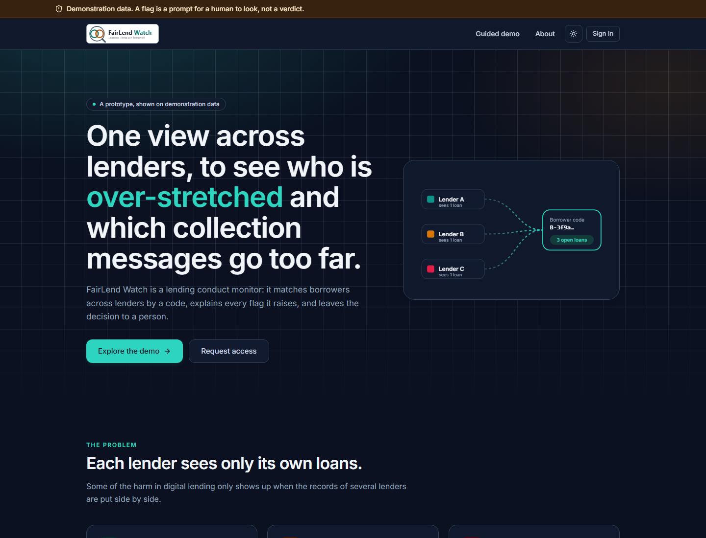
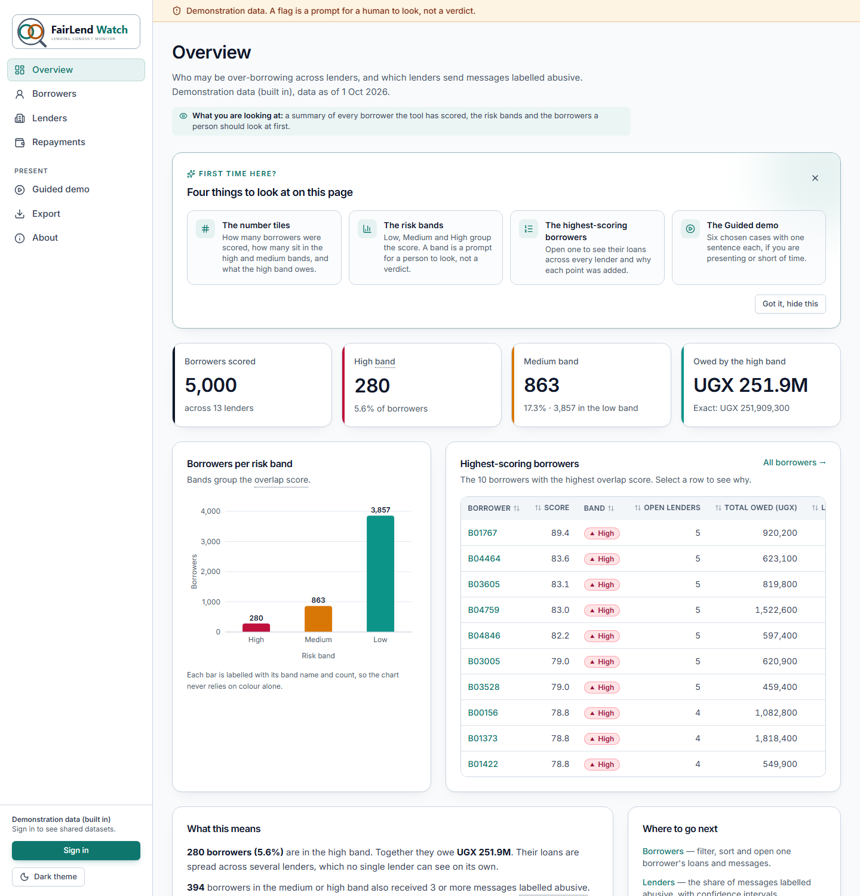
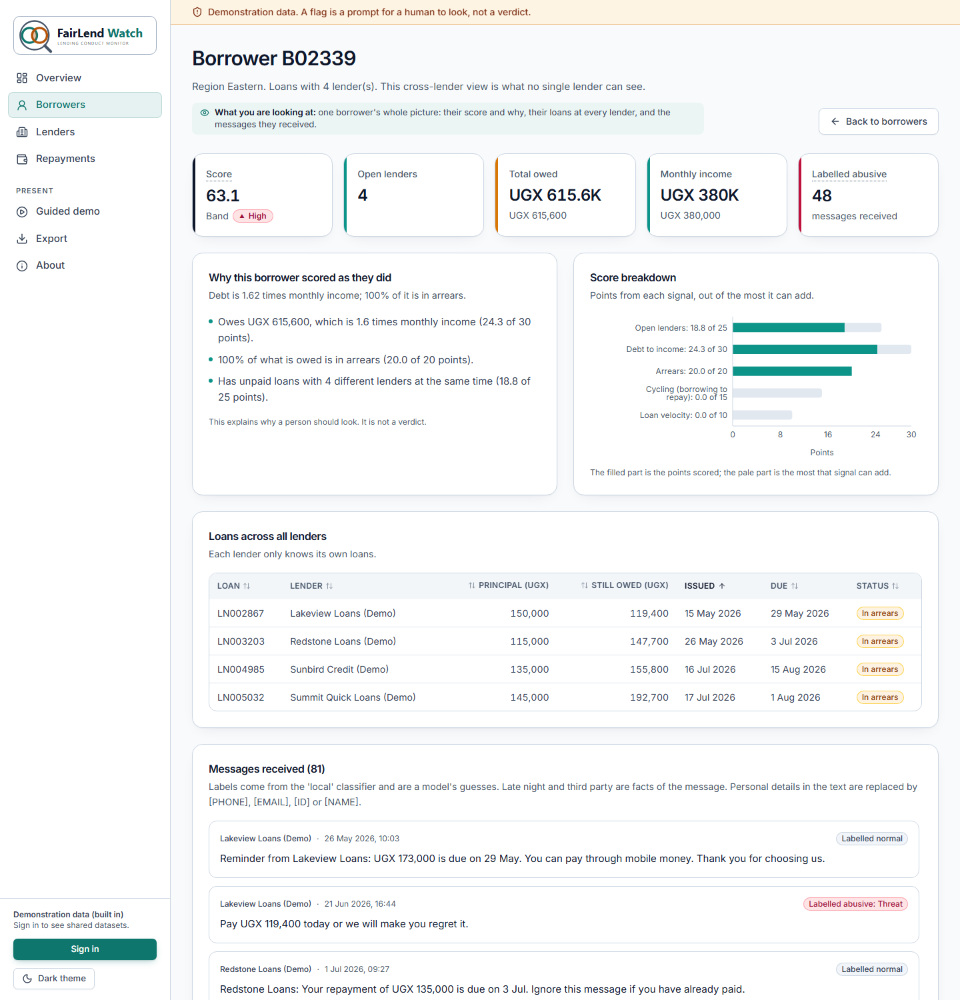
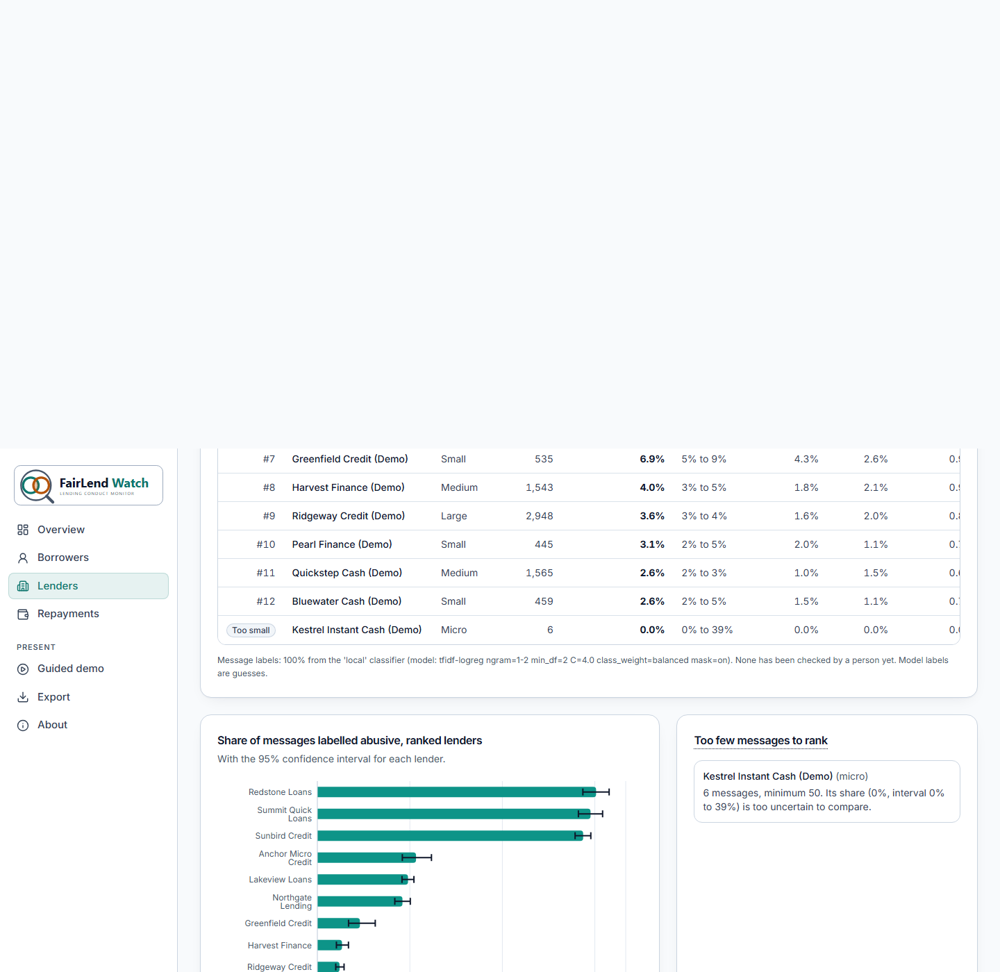
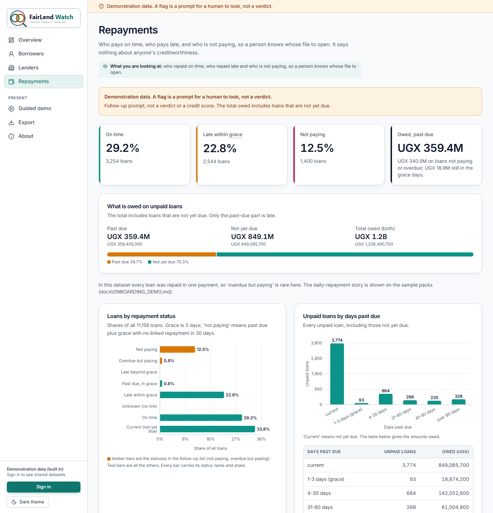

# FairLend Watch

**A lending conduct monitor: one view across lenders, to see who may be over-stretched and which collection
messages go too far.** It matches borrowers across lenders by a code, explains every flag it raises, and leaves the
decision to a person.

> **A prototype, shown on demonstration data.** The people, loans, lenders and messages in the demo are made up. A
> flag is a prompt for a human to look, not a verdict.

**Live demo:** _link to be added_



## What it does

* **Several loans at once.** Each lender sees only its own loans. Matched by a borrower code, the whole stack becomes
  visible. Every borrower gets a 0 to 100 score from five signals: open lenders, debt to income, arrears, borrowing
  to repay (cycling) and loan velocity. The score is grouped as Low, Medium or High, and every point is explained.
* **Borrowing from one lender to repay another.** A new loan taken days after clearing another is counted, and repeated
  cycling lifts a borrower to at least the medium band so a person looks.
* **Abusive collection messages.** A model labels the wording of each collection message as normal, firm pressure,
  threat, or shaming / third party. Lenders are compared by the share labelled abusive, ranked by the low end of a
  95% confidence interval, so a small lender cannot top the list by luck.
* **Repayments.** It shows who repaid on time, who repaid late and who is not paying, with a follow-up list. This is a
  prompt, not a credit score.
* **Privacy.** Codes instead of names. Phone numbers, emails and ID numbers are replaced in message text before
  anything is stored.

| | |
|---|---|
|  |  |
|  |  |

Every page, including the phone layout and the dark theme, is in [`docs/ui_v2_screens/`](docs/ui_v2_screens/).

## Run it on Windows

There are two ways to run it on the same engine and the same numbers:

* the **web app** (Next.js front end plus a small Python API), recommended;
* the original **Streamlit app**, kept as the fallback.

### One-time setup (PowerShell, in the project folder)

```powershell
py -m venv .venv
.\.venv\Scripts\python.exe -m pip install -r requirements-dev.txt
.\.venv\Scripts\python.exe -m pip install -r requirements-api.txt
npm --prefix web install
npm --prefix web run build
```

### The web app (two windows)

```powershell
# Window 1: the API on http://127.0.0.1:8000. The first start builds the demonstration data (about 30 seconds).
.\.venv\Scripts\python.exe -m api
```

```powershell
# Window 2: the web app on http://localhost:3000
npm --prefix web run start
```

Open http://localhost:3000 for the landing page, or go straight to the dashboard at http://localhost:3000/overview.
The demo needs no account. Full guide: [`docs/UI_V2.md`](docs/UI_V2.md).

### The Streamlit fallback

```powershell
.\dev.ps1            # starts the dashboard on http://localhost:8501 (this computer only)
.\dev.ps1 -Present   # presentation mode: demonstration data only
```

or directly:

```powershell
streamlit run app.py --server.address localhost
```

Its reference is in [`docs/STREAMLIT_REFERENCE.md`](docs/STREAMLIT_REFERENCE.md), the former README.

## Accounts and roles (web app)

The demo is open to everyone. Shared datasets need an account.

| Role | Can |
|---|---|
| Viewer | read every dataset |
| Importer | Viewer, plus import datasets and check message labels |
| Admin | Importer, plus approve access requests, manage users, delete datasets and read the audit log |

* **First Admin:** run `.\.venv\Scripts\python.exe -m api.create_admin`. It asks for the password at a hidden prompt.
* **Everyone else:** they **request access** on the public form. The account stays inactive until an Admin approves
  it as Viewer or Importer, or rejects it.
* **No email is ever sent.** People check back and sign in once approved.

## Tests

The Python suite runs in batches of test files, one process at a time, with no web or API server running. On
2026-11-16 the result was **882 passed, 0 failed** across 34 files; the batch table is in
[`docs/UI_V2.md`](docs/UI_V2.md). The browser tests (Playwright with an automated accessibility check) gave
**13 passed**: the landing page at phone and desktop width in both themes, keyboard paths through sign-in, request
access with approval, import and delete, and both themes.

```powershell
.\.venv\Scripts\python.exe -m pytest -q tests\test_api.py tests\test_api_auth.py tests\test_api_access.py
npm --prefix web run test:e2e
```

## Limits (read before relying on it)

* **Demonstration data.** It was generated to be separable, so accuracy on any other data will be lower, by an amount
  that has not been measured.
* **Message labels are a model's guesses about wording**, made by a model trained on the built-in demonstration text.
  They are not legal findings. Check a sample on the Review labels page.
* **A person decides.** A score, a band or a rank means "look at this file", never a verdict on a borrower or a lender.
* **A prototype.**
  * One API instance at a time.
  * No multi-factor sign-in, no password-reset email, no built-in backups.
  * Before anyone reaches it over a network, read [`docs/DEPLOY_V2.md`](docs/DEPLOY_V2.md) (HTTPS, secrets, rate limits).
  * For free hosting, read [`docs/DEPLOY_FREE.md`](docs/DEPLOY_FREE.md) (Neon, Render and Vercel).

## Where to read more

| Document | What |
|---|---|
| [`docs/UI_V2.md`](docs/UI_V2.md) | The web app: run it, accounts, imports, review, settings, tests, demo script |
| [`docs/DEPLOY_FREE.md`](docs/DEPLOY_FREE.md) | Step by step on Neon, Render and Vercel (prepared, not deployed) |
| [`docs/DEPLOY_V2.md`](docs/DEPLOY_V2.md) | What is safe to show publicly; HTTPS, secrets, backups |
| [`docs/DEMO_SCRIPT.md`](docs/DEMO_SCRIPT.md) | The 5-minute demo script and the hard questions |
| [`docs/STREAMLIT_REFERENCE.md`](docs/STREAMLIT_REFERENCE.md) | The Streamlit app, the engine, the data and the score in detail |
